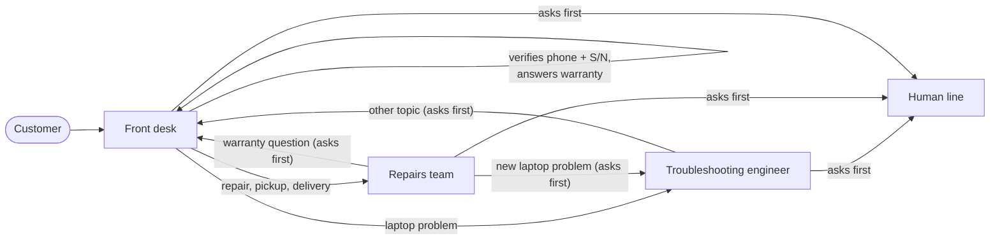

# Tier0

<p align="center"></p>

**An AI support desk for laptops that you talk to in your browser.**

When a laptop has a problem, people call customer care, wait on hold, and are often told to restart it. Tier0 is an AI layer in front of laptop customer care: it greets you, verifies you, checks your laptop safely, fixes common Windows problems, handles warranty and repair questions, and brings in a human only when it should.

No phone number and no app to install. You hold <kbd>Space</kbd> and talk.

---

## Contents

- [What it does](#what-it-does)
- [How a call works](#how-a-call-works)
- [The agents](#the-agents)
- [Diagnostic tools](#diagnostic-tools)
- [Safety and security](#safety-and-security)
- [Voice](#voice)
- [Setup](#setup)
- [Demo accounts](#demo-accounts)
- [Tech stack](#tech-stack)
- [Project structure](#project-structure)
- [API](#api)
- [Evals](#evals)
- [How it was built](#how-it-was-built)
- [Limitations and next steps](#limitations-and-next-steps)

---

## What it does

- **Voice-first support call in the browser.** Hold <kbd>Space</kbd> (or the mic button) to talk, and let go to send. The agent stops speaking the moment you press.
- **Four agents that hand the call to each other** like a real support team: a front desk, a troubleshooting engineer, a repairs team and a human line.
- **Real diagnostics on the customer's laptop:** 20 read-only Windows checks (CPU and memory, battery health, disks, Wi-Fi, crashes, drivers and more), each run only after the customer clicks **Allow**.
- **Fixes, not just answers.** The engineer explains readings in plain words, suggests concrete steps, asks if they worked, and tries again or escalates.
- **Warranty, repairs, pickups and deliveries** from a real database, including rescheduling a pickup or delivery, which is only saved after the customer confirms.
- **A human is always offered, never forced.** Before any transfer to a person, the agent asks: *"Would you like me to transfer you to a human agent now, or is there anything else you'd like to ask first?"*

## How a call works



1. **Front desk** greets the customer, finds out what they need, and verifies them with their **registered phone number and the full serial number (S/N)** of their laptop.
2. It answers **warranty and laptop questions** itself, and routes everything else, announcing the transfer: *"I'm transferring you to our troubleshooting AI engineer now."*
3. The next agent **introduces itself and sums up the issue**, so the customer never repeats themselves.
4. When the problem is solved, the agent asks **"Is there anything else I can help you with?"** and only transfers if the customer says yes.
5. If the customer says they're done, the agent says goodbye and the call ends.

While an agent works, it fills the silence with a short phrase ("Okay, let me check that for you"), and the customer can add more at any time: an answer still being prepared is dropped, and both messages are answered together.

## The agents

| Agent | What it does | Tools |
|---|---|---|
| **Front desk** | Greets, finds out what the customer needs, verifies them once for the whole call, answers warranty and laptop questions, and routes to the right team. | `verify_customer`, `get_my_laptops_and_warranties` |
| **Troubleshooting engineer** | Diagnoses Windows problems in a loop: understand → check → explain → fix → confirm it worked. Mentions hardware faults (for example a worn battery) without hijacking the call, and offers a human engineer for repairs. | The 20 [diagnostic tools](#diagnostic-tools) |
| **Repairs team** | Repair status in plain words, the reason for any delay, cost or warranty cover, and booking or moving a pickup or delivery (confirmed by the customer before it's saved). | `get_my_repairs`, `get_available_slots`, `reschedule_visit` |
| **Human line** | Takes over when the customer accepts a transfer, with the full case attached. No human agents are live in this demo, so it says so, keeps the case, and ends the call. | (none) |

Every agent returns a **structured decision** validated with Zod (for example the next action, a confidence score, the findings so far and fix steps), so the server, not the model, decides what happens next.

## Diagnostic tools

All 20 checks are **read-only** PowerShell scripts fixed in the code. The model can only pick a check by name; it never writes commands. Each check is shown to the customer for approval before it runs.

| Check | Typical problem |
|---|---|
| Laptop and Windows details | Basic system information |
| CPU and memory usage | Slow, lagging, freezing |
| Apps that start with Windows | Slow start-up |
| Free space on your drives | Storage full |
| Drives Windows can see | Missing or external drive not showing |
| Drive health | Failing disk |
| Battery health | Battery drains fast, won't charge |
| Power and sleep settings | Won't sleep, screen turns off |
| Temperature and CPU throttling | Hot, loud fan, slows down under load |
| Network and internet connection | No internet |
| Wi-Fi signal and adapter | Wi-Fi drops or is slow |
| Devices with driver problems | Device not working |
| Crash and blue screen history | Blue screens, sudden restarts |
| Recent Windows error logs | Apps crashing, general errors |
| Windows Update status | Updates failing |
| Recently installed programs and drivers | "It started after I installed something" |
| Display and graphics | Flickering, external monitor, blurry text |
| Sound devices | No sound, microphone not working |
| Keyboard, touchpad, USB and camera | Input or webcam not working |
| Antivirus and firewall status | "Is my laptop protected?" |

Results are annotated before the model sees them (for example Windows error codes and blue-screen codes are explained in plain words), so the engineer reasons from meaning, not raw numbers.

## Safety and security

- **Credentials never reach the AI.** Phone numbers, serial numbers and emails are replaced with `[phone number]` / `[serial number]` before any model or guardrail sees a message. The server extracts and checks them itself.
- **Two-factor verification** (registered phone + full laptop S/N), with limits: 3 failed attempts per call (then a human takes over), 5 failed attempts per phone number per hour, and per-IP rate limits on every endpoint.
- **Guardrails on input and output.** Every customer message is checked for prompt injection, harmful requests and off-topic use; every reply is checked for leaked secrets, unsafe commands or private data before it's spoken.
- **Nothing runs or changes without the customer's OK.** Diagnostics need **Allow**; a booking change needs **Confirm**. The server double-checks both, for example a time slot the customer never heard can't be booked.
- **Tool output is untrusted data.** Diagnostic results are wrapped and filtered so text inside them can't instruct the model, and usernames, machine names and account IDs are scrubbed out.
- **Server-enforced policy, not just prompts:** per-reply and per-case check limits, confidence caps, hardware rules, and transfer rules all live in code.
- **The voice endpoints can't be abused** to generate arbitrary audio: the server only speaks lines the agents actually said in that call, plus a fixed list of filler phrases.
- **Local by design:** the server binds to `127.0.0.1` and only accepts the local web client (CORS), because it can run diagnostics on the machine.

## Voice

- **Hold-to-talk:** hold <kbd>Space</kbd> or the mic button. Pressing stops the agent instantly; only what you say while holding is recorded.
- **OpenAI voice** when an API key is set: `gpt-4o-mini-transcribe` for speech-to-text and `gpt-4o-mini-tts` for natural agent voices, each agent with its own voice. Otherwise it falls back to the browser's own speech (Chrome and Edge).
- **One speaking queue:** lines, fillers and transfer chimes play one at a time and never overlap; transcript lines and approval cards appear as they're spoken.
- **Transfers sound like a call being put through:** the current agent announces it, a short chime plays, and the next agent introduces itself.

## Setup

### Prerequisites

- **Windows 10 or 11.** The diagnostic tools use Windows PowerShell 5.1 and run on the machine the server runs on.
- **Node.js 20+** (developed on Node 22).
- **Docker Desktop**, for PostgreSQL.
- **An OpenAI API key** (the agents use `gpt-4o-mini`; a demo call costs about 3 to 4 cents with OpenAI voice).
- **Chrome or Edge** recommended.

### Steps

```bash
# 1. Install dependencies (client and server are npm workspaces)
npm install

# 2. Start PostgreSQL (localhost:5434)
docker compose up -d

# 3. Configure the server
cp server/.env.example server/.env
#    then set OPENAI_API_KEY in server/.env

# 4. Create the tables and load the demo customers
npm run db:migrate -w server
npm run db:seed -w server

# 5. Run the server (http://127.0.0.1:3001) and the web app (http://localhost:5173)
npm run dev
```

Open **http://localhost:5173**. A welcome guide helps you pick a demo account and an issue to try.

> Re-run `npm run db:seed -w server` before a demo: demo dates (like "pickup tomorrow") are relative to the day you seed, and it undoes any test bookings.

### Environment variables (`server/.env`)

| Variable | Default | Purpose |
|---|---|---|
| `OPENAI_API_KEY` | (required) | Agents, guardrails and OpenAI voice |
| `OPENAI_MODEL` | `gpt-4o-mini` | Model for all agents |
| `OPENAI_TTS_MODEL` | `gpt-4o-mini-tts` | Agent voices |
| `OPENAI_STT_MODEL` | `gpt-4o-mini-transcribe` | Customer speech-to-text |
| `DATABASE_URL` | local Docker database | PostgreSQL connection |
| `PORT` / `HOST` | `3001` / `127.0.0.1` | Server address |
| `CLIENT_ORIGINS` | `http://localhost:5173,...` | Allowed web clients (CORS) |
| `CHAT_RATE_LIMIT_PER_MINUTE` | `20` | Chat requests per IP per minute |
| `VOICE_RATE_LIMIT_PER_MINUTE` | `40` | Voice requests per IP per minute |
| `LOG_LEVEL` | `info` | Server log level |

## Demo accounts

Seeded customers to try every agent. Say the phone number and S/N when the front desk asks.

| Customer | Phone | Laptop S/N | Situation | Try saying |
|---|---|---|---|---|
| Aarav | 9000000001 | NHQN4SI00134501 | Acer Aspire 7, warranty active, no repairs | "My laptop is really slow and lagging." / "What does my warranty cover?" |
| Ananya | 9000000004 | PF4KX9ZD | Pickup booked for tomorrow | "When is my pickup? Can I move it to Friday?" |
| Vikram | 9000000005 | R6NRCX03A114 | Repaired, ready for delivery | "When will my laptop be delivered?" |
| Rohan | 9000000003 | 5CD2419XKQ | Repair waiting for a part | "Why is my repair taking so long?" / "I want to talk to a real person." |

Other laptop issues the engineer can diagnose: battery draining fast, Wi-Fi dropping, no sound, storage full, blue screens, Windows Update failing, overheating.

## Tech stack

| Area | Technology |
|---|---|
| Agents | [OpenAI Agents SDK](https://github.com/openai/openai-agents-js) (`@openai/agents`), `gpt-4o-mini`, Zod structured outputs, input/output guardrails, tool approvals |
| Server | Node.js, Express 4, TypeScript, pino logging, express-rate-limit |
| Database | PostgreSQL 16 (Docker), Drizzle ORM |
| Diagnostics | Windows PowerShell 5.1, fixed read-only scripts |
| Voice | OpenAI `gpt-4o-mini-tts` and `gpt-4o-mini-transcribe`, Web Speech API fallback, AudioWorklet recording |
| Web app | React 18, Vite, TypeScript, plain CSS |

## Project structure

```
client/                     React web app
  src/components/           Lobby, call screen, agent avatar, transcript, case panel, welcome guide
  src/hooks/                Conversation state, voice (speaking queue, hold-to-talk), browser speech
  src/audio/                Microphone recorder, transcript noise filter
server/
  src/common/               Errors, API responses, middleware, guardrails, agent history
  src/db/                   Drizzle schema, seed data
  src/modules/
    conversations/          One call: routing, handoffs, transfers, transcript
    frontdesk/              Front desk agent, verification and warranty tools
    troubleshoot/           Engineer agent, 20 diagnostic tools, PowerShell runner, policy
    status/                 Repairs agent, repair queries, time slots, rescheduling
    customers/              Customer lookup and two-factor verification
    voice/                  OpenAI speech and transcription, filler phrases
  drizzle/                  SQL migrations
docker-compose.yml          PostgreSQL
```

## API

All responses use one envelope: `{ success, message, data }` or `{ success: false, message, error: { code, details } }`.

| Method | Path | Purpose |
|---|---|---|
| `POST` | `/api/conversations` | Start a call (returns the greeting) |
| `GET` | `/api/conversations/:id` | The call's state and transcript |
| `POST` | `/api/conversations/:id/messages` | Send what the customer said |
| `POST` | `/api/conversations/:id/approval` | Answer a check or booking change (`{ approve }`) |
| `GET` | `/api/conversations/:id/speech/:index` | An agent line as audio (MP3) |
| `POST` | `/api/conversations/:id/transcribe` | Customer speech (WAV) to text |
| `GET` | `/api/voice/fillers` | Filler phrases |
| `GET` | `/api/troubleshoot/tools` | The diagnostic tools |
| `GET` | `/api/health` | Server, database and voice status |

## Evals

`evals/run.mjs` runs scripted calls against the live server with the real model (`gpt-4o-mini`) and the demo customers, checks each outcome, and runs every diagnostic tool on its own. Full results: [evals/results.md](evals/results.md).

**Latest run: 9/10 conversation scenarios passed, 20/20 diagnostic tools ran and returned data. Median reply time 5.9 s.**

| Scenario | Result |
|---|---|
| Verifies a customer with the right phone and S/N | ✅ |
| Refuses a wrong serial number | ✅ |
| Answers a warranty question at the front desk | ✅ |
| Does not mention the warranty unasked | ✅ |
| Hands a slow laptop to the troubleshooting engineer | ✅ |
| Asks before running a check, then runs it after **Allow** | ✅ |
| Routes a pickup question to the repairs agent | ❌ |
| Asks before transferring to a human | ✅ |
| Transfers to the human line after a yes, and ends the call | ✅ |
| Blocks a prompt-injection attempt | ✅ |

**Known failure:** asked *"When is my pickup?"*, the front desk sometimes offers a human instead of handing the call to the repairs agent. Next: tighten the front desk's routing for pickup and delivery questions.

Run it yourself with the server up: `node evals/run.mjs`.

## How it was built

Tier0 was built solo for the Openfire / Alan AI hackathon using the **Alan AI harness, with Claude Code as the coding agent** in the terminal. I designed the product, the agents' behaviour and the safety rules, and built it step by step: each piece tested against real calls and committed in small steps.

## Limitations and next steps

- **Diagnostics run on the machine running the server.** For real customers this would be a small signed helper app that runs the same read-only checks on their laptop.
- **Calls are kept in memory**, so a server restart ends calls in progress. Next: store calls and cases in PostgreSQL.
- **No live human agents yet:** escalated cases are kept with their full summary. Next: an engineer queue to pick them up.
- **Verification is phone + S/N.** Next: a one-time code by SMS.
- **Windows only** for diagnostics.
